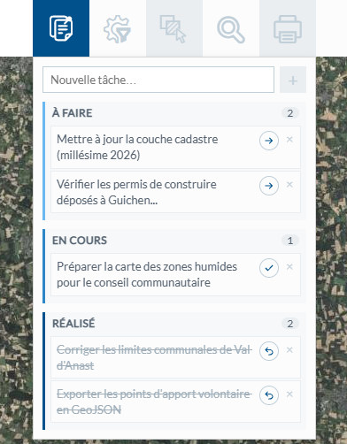
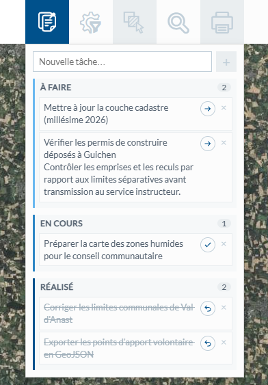
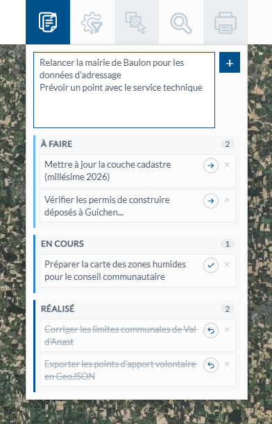

# GeoNotes

Extension pour **GEO** qui ajoute dans l'en-tête de l'application un petit tableau de tâches personnel (façon kanban) :

- **À faire** → **En cours** → **Réalisé**
- ajout d'une tâche multi-ligne (`Ctrl+Entrée` pour valider) ;
- extrait sur 2 lignes, texte complet affiché au clic ;
- passage d'une colonne à l'autre, remise en cours, suppression ;
- sauvegarde dans le `localStorage` du navigateur, synchronisée entre les onglets ouverts.

> Les tâches sont stockées localement dans le navigateur : elles ne sont ni partagées entre utilisateurs ni entre postes.

## Aperçu

| Tableau des tâches | Texte complet au clic | Ajout d'une tâche |
| :---: | :---: | :---: |
|  |  |  |

- **Tableau des tâches** : le bouton GeoNotes de l'en-tête ouvre les trois colonnes, avec le nombre de tâches de chacune.
- **Texte complet au clic** : une tâche longue est tronquée sur 2 lignes ; un clic l'affiche en entier.
- **Ajout d'une tâche** : le champ s'agrandit à la saisie, `Entrée` passe à la ligne et `Ctrl+Entrée` (ou le bouton **+**) ajoute la tâche dans **À faire**.

## Installation

1. Télécharger `GeoNotes-<version>.zip` depuis la page [Releases](../../releases).
2. Dans l'administration GEO, importer le zip comme nouvelle extension (ou mettre à jour l'extension existante).
3. Activer l'extension dans l'application souhaitée.

## Configuration

Si vous souhaitez que le module ne soit accessible que pour certains utilisateurs, vous devez créer une configuration et y associé le groupe dédié en lecture uniquement.

Version minimale de GEO : **3.0.0**.